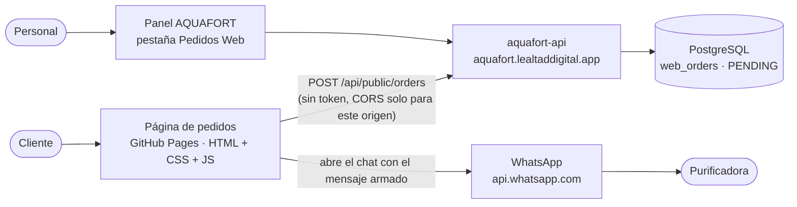
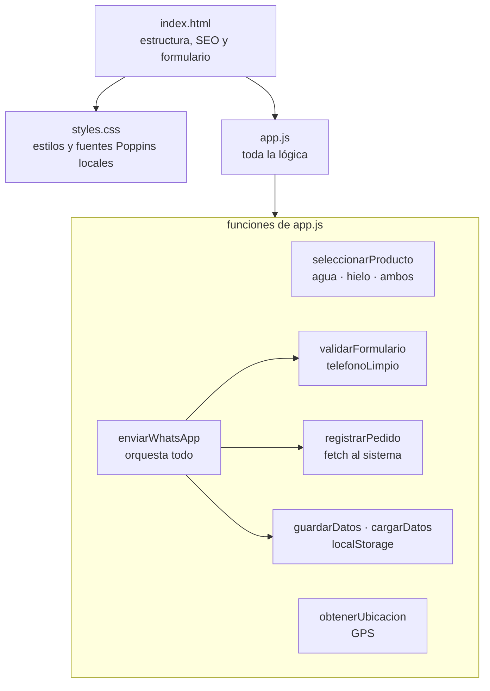
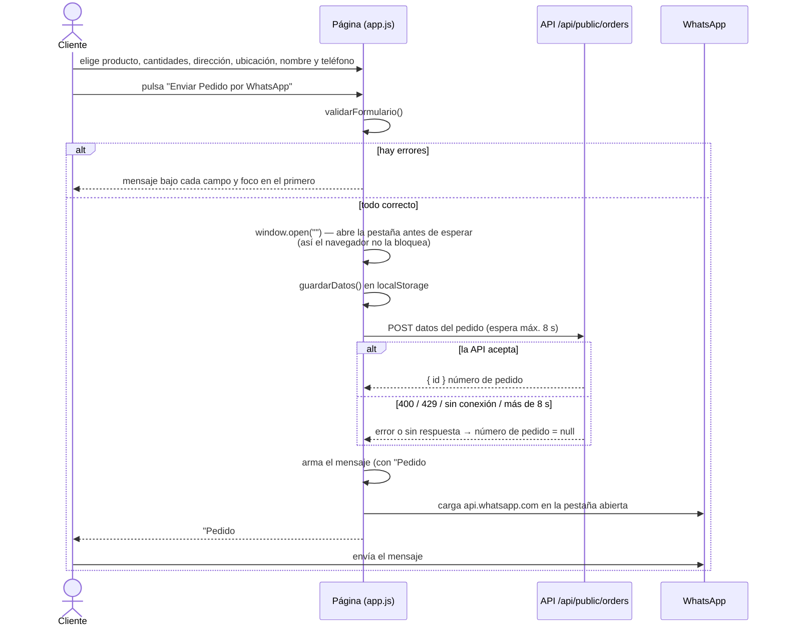
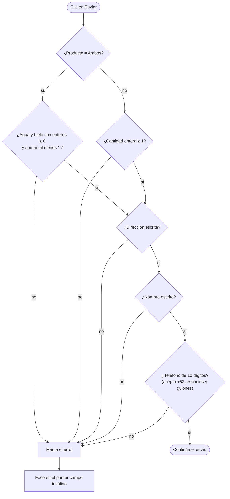
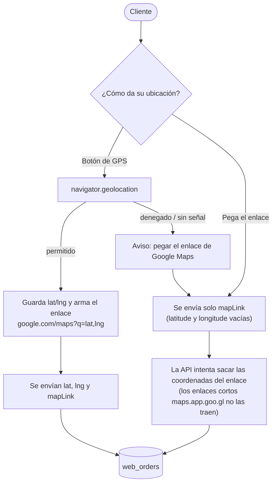
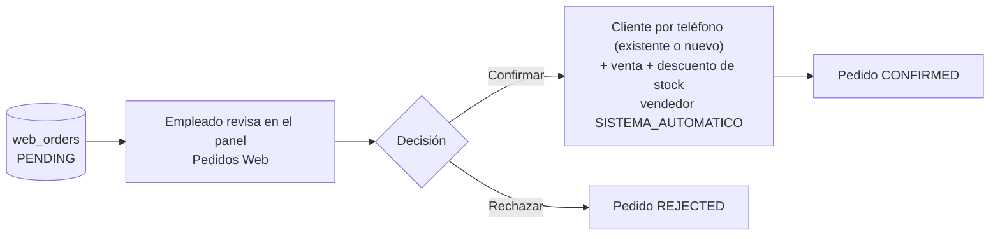
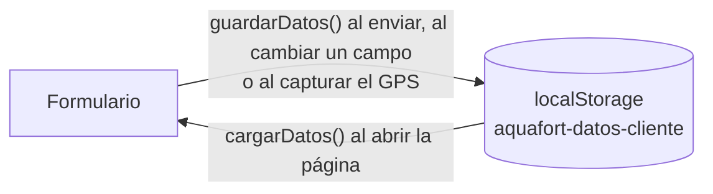
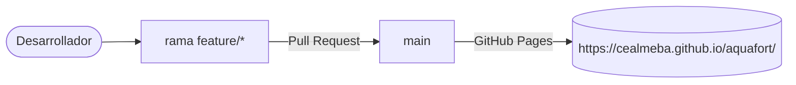

# Aquafort – Página de pedidos

Página pública de la purificadora Aquafort (Fortín, Ver.) para que los clientes pidan garrafones de agua y bolsas de hielo a domicilio.

Publicada en GitHub Pages: **https://cealmeba.github.io/aquafort/**

Es HTML, CSS y JavaScript sin dependencias ni compilación: `index.html`, `styles.css` y `app.js`.

## Arquitectura y flujo de la información

Los diagramas están en [Mermaid](https://mermaid.js.org/): GitHub y IntelliJ los dibujan solos al abrir este archivo.

**Índice**
1. [Dónde encaja la página](#1-dónde-encaja-la-página)
2. [Estructura de la página](#2-estructura-de-la-página)
3. [Flujo de un pedido](#3-flujo-de-un-pedido)
4. [Validación del formulario](#4-validación-del-formulario)
5. [Ubicación del cliente](#5-ubicación-del-cliente)
6. [Qué pasa después en el sistema](#6-qué-pasa-después-en-el-sistema)
7. [Datos que se guardan en el navegador](#7-datos-que-se-guardan-en-el-navegador)
8. [Publicación](#8-publicación)

---

### 1. Dónde encaja la página



La página no tiene servidor ni compilación. Hay dos caminos para el pedido: el **sistema** (queda registrado como pendiente) y **WhatsApp** (el cliente lo termina de enviar). Si el sistema falla, WhatsApp funciona igual.

### 2. Estructura de la página



### 3. Flujo de un pedido



Cuerpo que se envía a la API:

```json
{ "name": "...", "phone": "2711234567", "address": "...", "latitude": 18.90, "longitude": -96.99,
  "mapLink": "https://www.google.com/maps?q=...", "water": 2, "ice": 1, "website": "" }
```

`website` es un campo trampa invisible: si un robot lo llena, el sistema descarta el pedido.

### 4. Validación del formulario



La API vuelve a validar todo: la validación de la página es solo para dar respuesta rápida.

### 5. Ubicación del cliente



### 6. Qué pasa después en el sistema



Si el pedido no se registró (sistema caído), el personal lo captura a mano desde el mensaje de WhatsApp. Detalle completo en el README del repo `api-hydroflow`.

### 7. Datos que se guardan en el navegador



Se recuerdan nombre, teléfono, dirección, enlace de mapa y coordenadas para el siguiente pedido. No se guardan productos ni cantidades. Si el navegador no permite `localStorage`, la página funciona igual.

### 8. Publicación



Antes de cambiar algo del pedido: la API se despliega primero, luego el front y al final la página. Si la página se adelanta, los pedidos siguen llegando por WhatsApp pero no se registran en el sistema.

## Historias de usuario

Rol: **Cliente** (sin cuenta) y **Personal** de la purificadora.

| ID | Historia | Criterios de aceptación |
|---|---|---|
| HU-P01 | Como **cliente**, quiero elegir agua, hielo o ambos y las cantidades para pedir lo que necesito. | Al elegir "Ambos" aparecen dos cantidades. La cantidad debe ser entera y de al menos 1 (con "Ambos", al menos 1 entre agua y hielo). |
| HU-P02 | Como **cliente**, quiero compartir mi ubicación con un botón para que me encuentren sin dar indicaciones. | El botón usa el GPS. Si no hay permiso o señal, puedo pegar un enlace de Google Maps. |
| HU-P03 | Como **cliente**, quiero dejar mi nombre, teléfono y dirección para que me ubiquen y me contacten. | El teléfono es de 10 dígitos (acepta +52, espacios y guiones). Los errores salen bajo cada campo y el foco va al primero. |
| HU-P04 | Como **cliente**, quiero enviar mi pedido por WhatsApp para confirmar con la purificadora. | Se abre WhatsApp con el mensaje armado: productos, dirección, ubicación, nombre y teléfono. |
| HU-P05 | Como **cliente**, quiero recibir un número de pedido para poder dar seguimiento. | Si el sistema registra el pedido, el mensaje incluye "🧾 Pedido #N". |
| HU-P06 | Como **cliente**, quiero poder pedir aunque el sistema falle para no perder mi pedido. | Si la API no responde en 8 segundos o no hay conexión, WhatsApp se abre igual, sin número de pedido. |
| HU-P07 | Como **cliente frecuente**, quiero que la página recuerde mis datos para no escribirlos otra vez. | Se recuerdan nombre, teléfono, dirección, enlace y ubicación en el navegador. No se guardan productos ni cantidades. |
| HU-P08 | Como **personal**, quiero que cada pedido llegue al panel como pendiente para confirmarlo sin recapturar. | El pedido queda `PENDING` en Pedidos Web con teléfono, dirección y ubicación. |
| HU-P09 | Como **dueño del negocio**, quiero que los robots no puedan llenar el sistema de pedidos falsos. | Campo trampa invisible; la API limita pedidos por IP y por pendientes totales. |

## Cómo funciona un pedido
1. El cliente elige producto (agua, hielo o ambos) y cantidades, escribe su dirección, comparte su ubicación (botón de GPS o enlace de Google Maps), su nombre y su **teléfono a 10 dígitos**.
2. Al pulsar **Enviar Pedido por WhatsApp**, la página manda el pedido al sistema de la purificadora (`POST https://aquafort.lealtaddigital.app/api/public/orders`). Ahí queda como **pendiente**.
3. Después abre WhatsApp con el mensaje armado, que incluye el número de pedido (`🧾 Pedido #N`) y el teléfono. El cliente termina de enviarlo.
4. Un empleado confirma o rechaza el pedido en el panel de AQUAFORT (**Pedidos Web**). Al confirmar se da de alta al cliente y se registra la venta.

Si el sistema no responde en 8 segundos o no hay conexión, WhatsApp se abre de todos modos (sin número de pedido): el pedido nunca se pierde, solo no queda registrado y el personal lo captura a mano.

La pestaña de WhatsApp se abre **antes** de esperar al sistema, para que el navegador no la bloquee como ventana emergente; si aun así se bloquea, WhatsApp se abre en la misma pestaña.

## Configuración (`app.js`)
| Constante | Para qué | Valor |
|---|---|---|
| `TELEFONO_WHATSAPP` | Número que recibe los pedidos (con `521` delante) | `5212711482917` |
| `API_PEDIDOS` | Endpoint del sistema que registra el pedido | `https://aquafort.lealtaddigital.app/api/public/orders` |
| `ESPERA_API_MS` | Tiempo máximo de espera al sistema antes de abrir WhatsApp | `8000` |

Los teléfonos de la sección de contacto y de los datos para Google (`index.html`: 271 148 2917 y 271 139 7573) son aparte: si cambia el número de WhatsApp, actualízalos también.

## Datos que se envían al sistema
```json
{ "name": "...", "phone": "2711234567", "address": "...", "latitude": 18.90, "longitude": -96.99,
  "mapLink": "https://www.google.com/maps?q=...", "water": 2, "ice": 1, "website": "" }
```
- `latitude`/`longitude` salen del GPS. Si el cliente pega o edita el enlace a mano, se envían vacías y el sistema saca las coordenadas del enlace (los enlaces cortos `maps.app.goo.gl` no las traen).
- `website` es un campo trampa invisible (`.campo-trampa`): una persona no lo ve; si un robot lo llena, el sistema descarta el pedido.
- El sistema acepta como máximo 5 pedidos por conexión por hora y de 0 a 50 unidades por producto.

El navegador recuerda nombre, teléfono, dirección, enlace y ubicación del cliente (`localStorage`, clave `aquafort-datos-cliente`) para el siguiente pedido.

## Requisitos del lado del sistema
La API debe permitir el origen de esta página: `APP_CORS_PUBLIC_ORIGINS=https://cealmeba.github.io` (ya configurado en producción, repo `api_aqua`, `deploy/k8s/prod/kustomization.yaml`). Si cambias el dominio de la página, actualiza esa variable.

## Probar en local
```bash
python -m http.server 5500
```
Abre `http://localhost:5500`. Para registrar pedidos contra una API local, cambia temporalmente `API_PEDIDOS` a `http://localhost:8080/api/public/orders` y arranca la API con `APP_CORS_PUBLIC_ORIGINS=http://localhost:5500`. No subas ese cambio.
